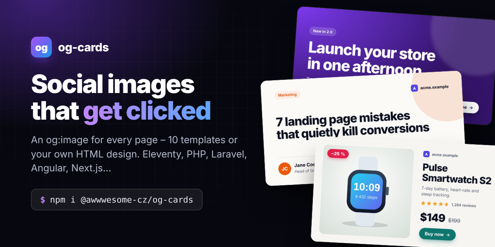
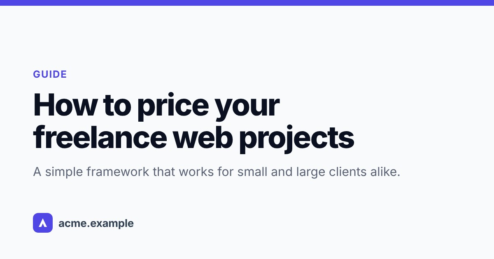
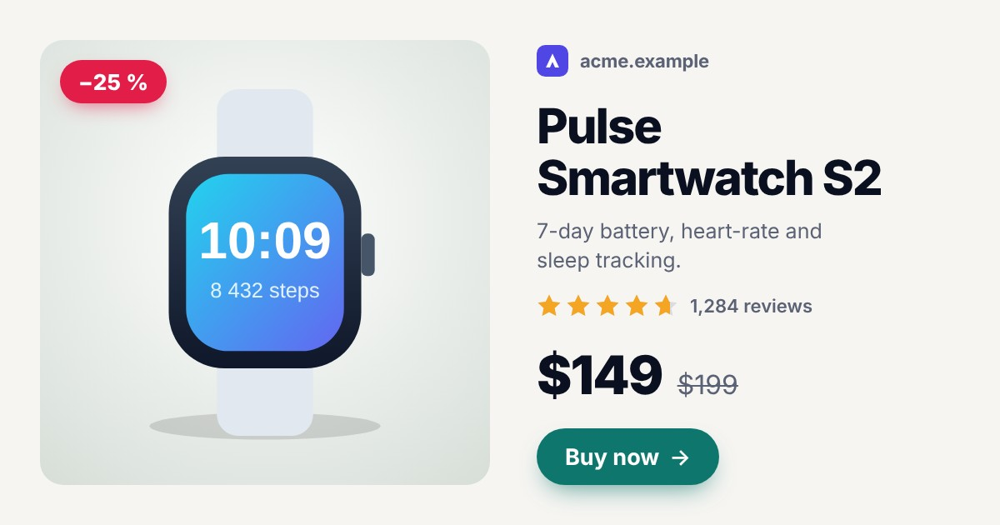
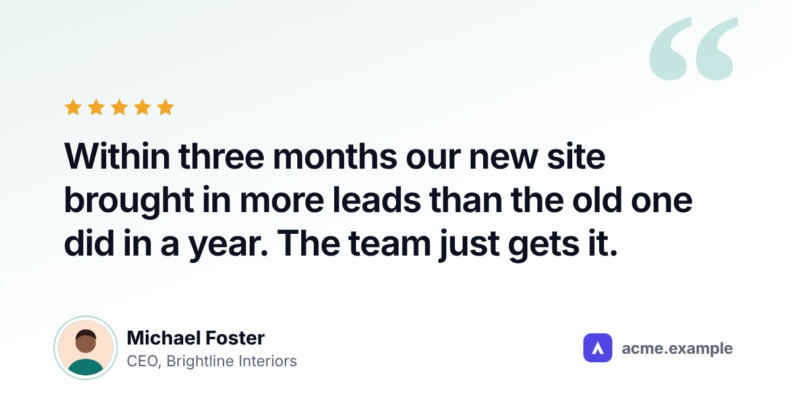
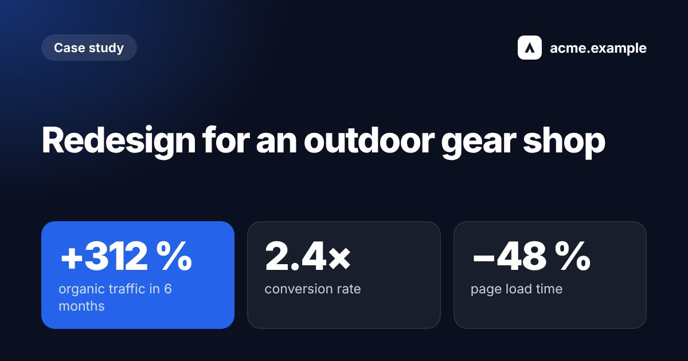
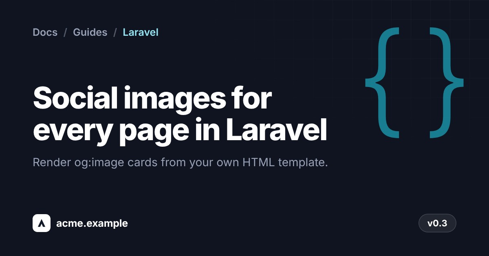

[](https://github.com/awwwesome-cz/og-cards)

# og-cards

[](https://www.npmjs.com/package/@awwwesome-cz/og-cards)
[](https://github.com/awwwesome-cz/og-cards/actions/workflows/ci.yml)
[](https://www.npmjs.com/package/@awwwesome-cz/og-cards)
[](LICENSE)
[](https://www.buymeacoffee.com/jakubforman)

**Social preview images that get clicked** – an `og:image` for every page of your site, rendered from one of
10 ready-made templates or from **your own HTML design**.

This is how they look when your pages are shared on X:


- **10 click-worthy templates** – articles, products with price and rating, events, testimonials, case-study numbers…
- **…or your own design** in HTML & CSS. It stays in your project – this package never needs it.
- **Any stack** – Eleventy plugin; plain PHP, Laravel, Angular, Astro, Next.js… via a page list and a JSON manifest.
- **Commit the images, or don't** – render locally and commit them, or render them during the build / in CI.
- **Only what changed is rendered** – every card is fingerprinted, and the image URL changes with it, so Facebook,
  LinkedIn and X always show the current version.

## Templates

| | |
|---|---|
| <br>**default** – any page | <br>**minimal** – homepage, services |
| <br>**bold** – launches, landing pages | <br>**article** – blog posts with author |
| <br>**split** – products, case studies | <br>**product** – price, discount, rating |
| <br>**event** – webinars, meetups | <br>**quote** – testimonials |
| <br>**stats** – results in numbers | <br>**docs** – documentation, guides |

Fields of every template and tips on what makes people click: [Built-in templates](docs/built-in-templates.md).
Your own design: [Your own template](docs/templates.md).

## Install

```bash
npm install --save-dev @awwwesome-cz/og-cards playwright
npx playwright install chromium   # once per machine
```

Node 20+.

## In 30 seconds

```js
// og.config.js
import { defineConfig } from "@awwwesome-cz/og-cards";

export default defineConfig({
  template: "bold",
  pages: [
    { url: "/", title: "Launch your store in one afternoon", description: "Payments and shipping included." },
    { url: "/about/", title: "About us" },
  ],
  card: (page) => ({ title: page.title, description: page.description, cta: "Start free", site: "example.com", logo: "logo.svg" }),
  outDir: "public/og",
  publicPath: "/og",
  manifest: "og-manifest.json",
});
```

```bash
npx og-cards
```

You get `public/og/home.jpg` and `public/og/about.jpg`, plus `og-manifest.json` mapping each page URL to its image.
Your site reads the manifest and prints the `<meta property="og:image">` tag.

## Documentation

**Start here**

| | |
|---|---|
| [How it works](docs/how-it-works.md) | Cards, templates, fingerprints, and the two modes: **commit** vs **build** |
| [Built-in templates](docs/built-in-templates.md) | The 10 templates, their fields, and what makes people click |
| [Your own template](docs/templates.md) | Designing the image in HTML/CSS, helpers, fonts, keeping your design private |

**Guides for your stack**

| Stack | Guide |
|---|---|
| Eleventy | [docs/guides/eleventy.md](docs/guides/eleventy.md) – plugin, no page list needed |
| Plain PHP | [docs/guides/php.md](docs/guides/php.md) |
| Laravel | [docs/guides/laravel.md](docs/guides/laravel.md) – incl. pages from the database |
| Angular | [docs/guides/angular.md](docs/guides/angular.md) – SSR / prerendering |
| Astro, Next.js, Vite, other JS | [docs/guides/javascript.md](docs/guides/javascript.md) |

**Reference**

| | |
|---|---|
| [CI / deployment](docs/ci.md) | GitHub Actions for both modes, caching, self-hosted runners, GitLab |
| [Configuration](docs/configuration.md) | Every option of `og.config.js` and the JavaScript API |
| [CLI](docs/cli.md) | `og-cards` command |

## Which mode should I use?

| | **commit** (default) | **build** (`mode: "build"`) |
|---|---|---|
| Where images are rendered | on your computer (`npx og-cards`) | during the build / in CI |
| In git | images + fingerprints file | nothing (only the template and config) |
| Needs Chromium in CI | no | yes |
| Good for | hosting without a build step, simple setups | sites built in CI, keeping the repository small |

Details: [How it works › Modes](docs/how-it-works.md#modes).

## Support

If og-cards saves you time, you can [buy me a coffee ☕](https://www.buymeacoffee.com/jakubforman). Thank you!

[](https://buymeacoffee.com/jakubforman)

## Support

If og-cards saves you time, you can [buy me a coffee ☕](https://www.buymeacoffee.com/jakubforman). Bug reports,
ideas and new templates are welcome in [issues](https://github.com/awwwesome-cz/og-cards/issues).

## License

MIT
