# Built-in templates

Ten ready-made templates, designed to get clicks in social feeds. Pick one by name:

```js
// og.config.js
export default defineConfig({
  template: "article",
  card: (page) => ({ title: page.title, author: page.author, date: page.date, site: "example.com", logo: "/logo.svg" }),
  // …
});
```

All of them use the bundled [Inter](https://rsms.me/inter/) font (incl. Czech, Polish, German… characters), so they look the
same on your Mac and in Linux CI. To change more than colours and texts, [copy a template into your project](templates.md#start-from-a-built-in-template).

- [Common fields](#common-fields)
- [default](#default) · [minimal](#minimal) · [bold](#bold) · [article](#article) · [split](#split)
- [product](#product) · [event](#event) · [quote](#quote) · [stats](#stats) · [docs](#docs)
- [What makes people click](#what-makes-people-click)

## Common fields

Every template understands these (all optional except `title`):

| Field | |
|---|---|
| `title` | The headline. Shrinks automatically when long. |
| `eyebrow` | Small label above the title (category, "New", "Case study"…). |
| `description` | One or two lines under the title. |
| `site` | Your domain or brand name, shown next to the logo. |
| `logo` | Logo image – see [Images](#images). Use a light logo on the dark templates (`bold`, `event`, `stats`, `docs`). |
| `accent` | Main colour, e.g. `"#e11d48"`. Every template is tinted by it. |
| `accent2` | Second gradient colour (`bold`). Default: a darker shade of `accent`. |
| `background` | Background colour of the light templates. |
| `cta` | Button text, e.g. `"Read more"` (`bold`, `split`, `product`, `event`). |
| `image` | Screenshot or photo (`split`, `product`). |

### Images

`logo`, `image` and `avatar` can be:

- a path relative to the project root: `"assets/logo.svg"`
- a site path starting with `/`, resolved against `publicDir` in your config: `"/images/logo.svg"` with `publicDir: "public"` → `public/images/logo.svg`
- a full URL (`https://…`, `data:…`) – works, but local files are faster and don't depend on the network in CI

SVG, PNG, JPEG and WebP all work.

---

## default

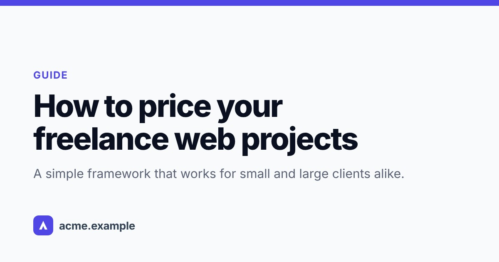

Clean light card with an accent bar. A safe choice for any page.

Fields: [common](#common-fields).

## minimal

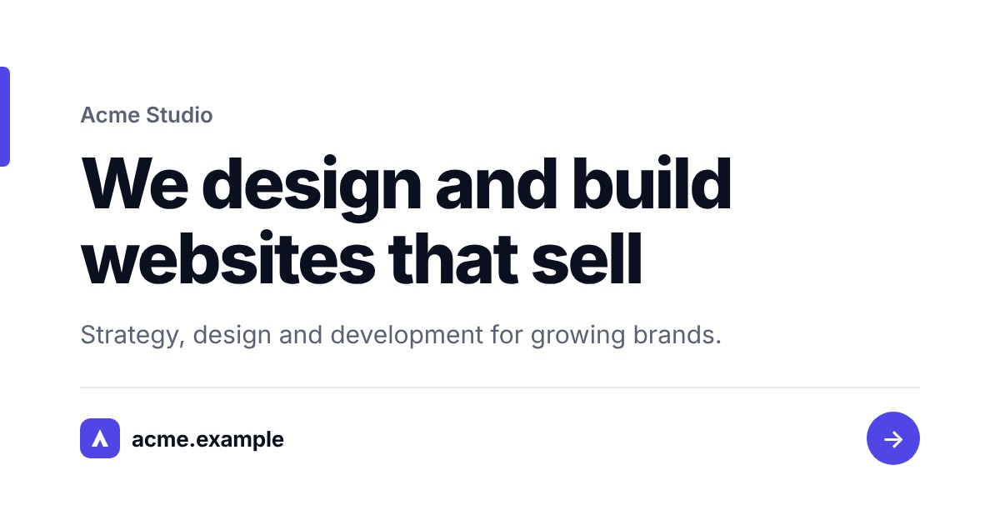

Lots of white space and one big headline – for homepages, service pages, portfolios.

Fields: [common](#common-fields).

## bold

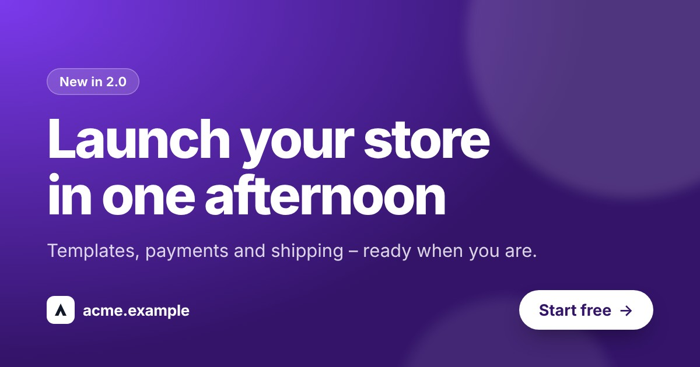

Full-bleed gradient, huge white headline and a button. Stands out in busy feeds – landing pages, launches, offers.

Fields: [common](#common-fields) incl. `cta`, `accent2`. Use a light `logo`.

## article

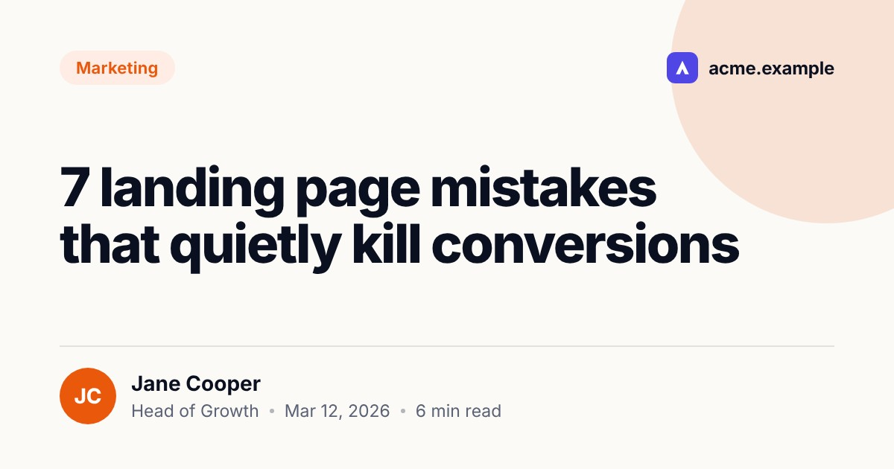

Blog posts and news. A face and a name next to the headline build trust.

| Field | |
|---|---|
| `author` | Author name. |
| `avatar` | Author photo. Without it the initials are shown. |
| `role` | e.g. `"Head of Growth"`. |
| `date` | Any text, e.g. `"Mar 12, 2026"`. |
| `readingTime` | e.g. `"6 min read"`. |

Plus [common](#common-fields) (`eyebrow` = category).

## split

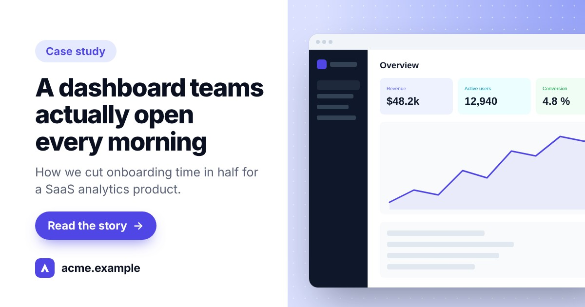

Text on the left, a screenshot or photo on the right – products, apps, case studies, portfolio items. Show the thing itself.

Fields: [common](#common-fields) incl. `image` (cropped from the top-left, so a full-page screenshot works) and `cta`.

## product

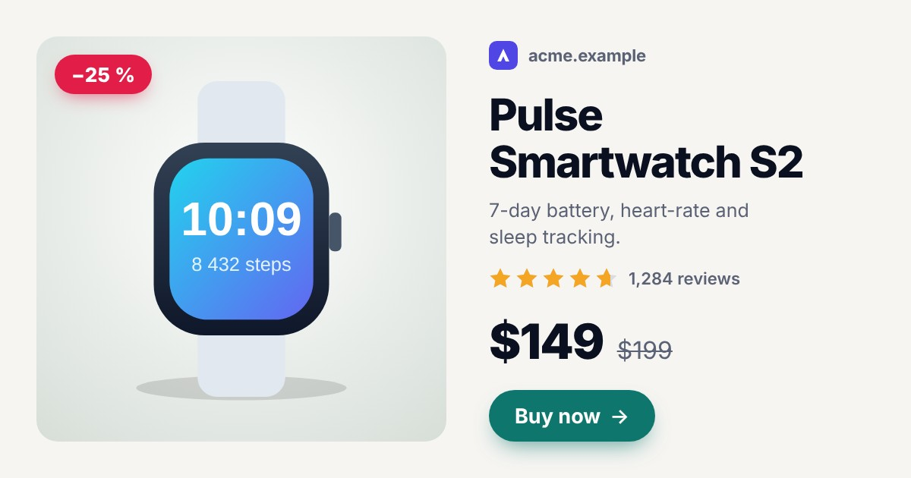

E-shop product or offer. Price, a crossed-out old price and stars are what make people click on a shared product.

| Field | |
|---|---|
| `image` | Product photo – ideally on a transparent or white background. |
| `price` | e.g. `"$149"`, `"1 290 Kč"`. |
| `oldPrice` | Crossed out next to the price. |
| `badge` | Red label on the photo, e.g. `"−25 %"`, `"New"`. |
| `rating` | 0–5, stars are filled proportionally (4.7 → 4 ¾ stars). |
| `reviews` | e.g. `"1,284 reviews"`. |

Plus [common](#common-fields) incl. `cta`.

## event

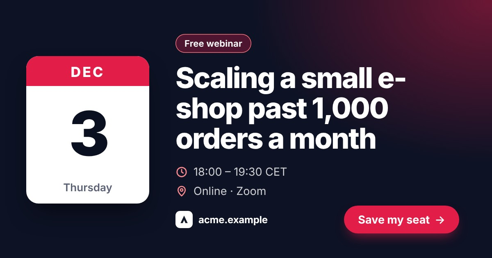

Webinars, meetups, conferences, launches. The date is the first thing people see.

| Field | |
|---|---|
| `date` | `"2026-12-03"` → calendar tile with month, day and weekday. Any other text (`"3–5 Dec"`) is shown as it is. |
| `locale` | Language of month and weekday names, e.g. `"cs"`. Default `"en"`. |
| `time` | e.g. `"18:00 – 19:30 CET"`. |
| `place` | e.g. `"Online · Zoom"`, `"Prague"`. |

Plus [common](#common-fields) incl. `cta` (`eyebrow` = event type). Use a light `logo`.

## quote

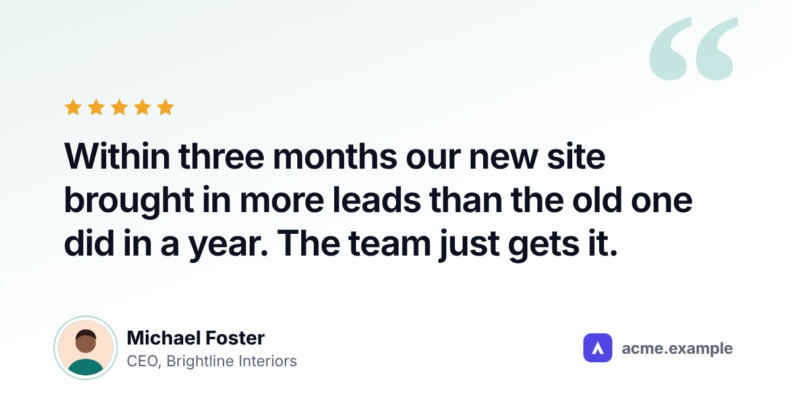

A testimonial or a quote – social proof with a real face and name.

| Field | |
|---|---|
| `quote` | The quote (or use `title`). |
| `author`, `avatar`, `role` | Who said it. Initials without `avatar`. |
| `rating` | Optional stars above the quote (0–5). |

Plus [common](#common-fields).

## stats

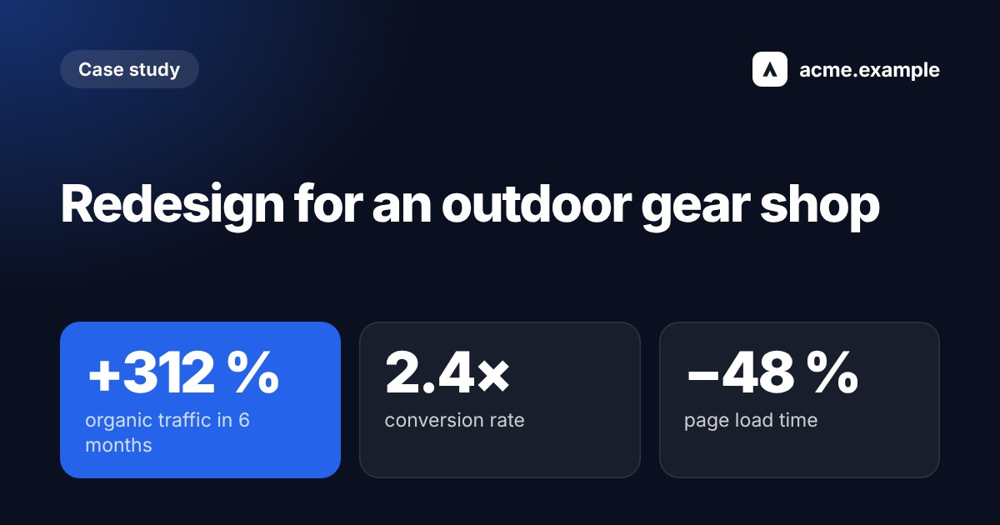

Case studies and results. Concrete numbers get clicks.

| Field | |
|---|---|
| `stats` | Up to three `{ value, label }`, e.g. `[{ value: "+312 %", label: "organic traffic" }]`. The first one is highlighted. |

Plus [common](#common-fields). Use a light `logo`.

## docs

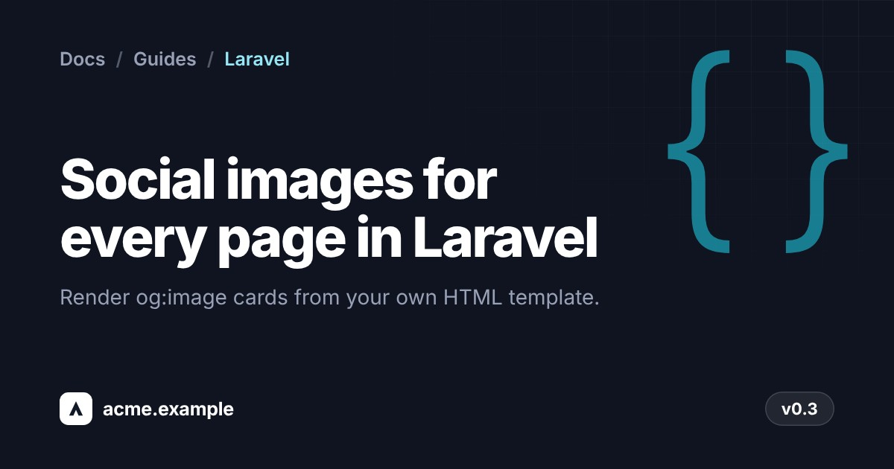

Documentation, guides, changelogs, developer content.

| Field | |
|---|---|
| `breadcrumb` | `["Docs", "Guides", "Laravel"]` or `"Docs / Guides / Laravel"`. The last part is highlighted. |
| `version` | e.g. `"v2.4"`. |

Plus [common](#common-fields). Use a light `logo`.

---

## What makes people click

How the cards look when shared:

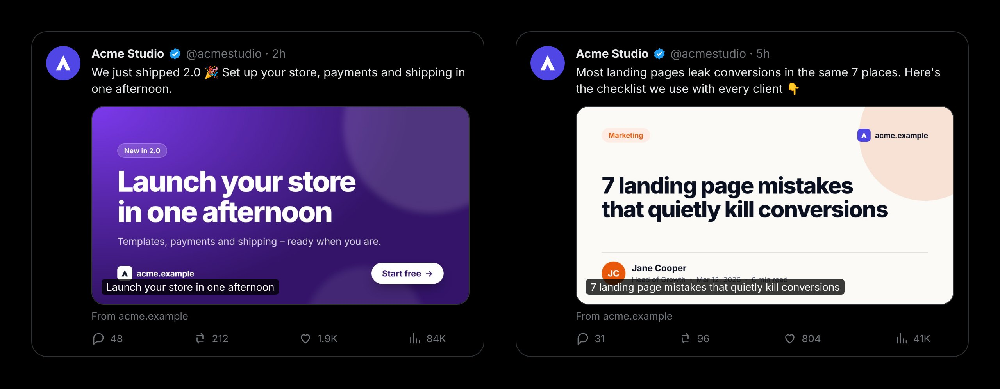

- **One clear headline, 4–9 words.** People scroll fast – the image is read in under a second. Don't repeat the whole
  description; the post text and the page title are shown next to the image anyway.
- **Big text.** The image is often shown 500 px wide or smaller (phones). Anything under ~24 px in the template is
  barely readable.
- **Keep the bottom-left corner calm.** X shows the page title over the bottom-left of the image; some apps add
  rounded corners or crop the edges. All templates keep important content away from the edges.
- **WhatsApp, iMessage and some chat apps crop to a square or smaller preview** – the centre of the image matters most.
- **A face, a number or a price beats a generic picture.** Use `article`/`quote` with real photos, `stats` with real
  results, `product` with the price.
- **Contrast with the feed.** Feeds are white or black – a coloured card (`bold`, `event`, `stats`) stands out in both.
- **Your brand on every card.** Logo + domain on every share builds recognition, even when nobody clicks.
- **One template per type of page.** Articles look like articles, products like products – people learn to recognise
  your content.

Check your pages with a preview tool such as [opengraph.xyz](https://www.opengraph.xyz) before sharing them.
